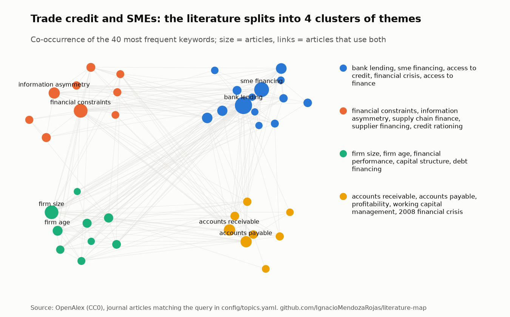

# literature-map

**Research tool: a bibliometric review that rebuilds itself every month.** For each research field it maps growth, themes, clusters, foundational works and under-connected themes, from open data (OpenAlex), so any reader can rerun it.

> I started with a bibliometric review of trade credit in SMEs built by hand from Scopus and VOSviewer. This repository makes the same review reproducible and keeps it current. It runs on open data and covers the three fields of my research: trade credit in SMEs, ownership and boards, and AI and labour costs.

## Results

*As of the first run, October 2026; the block below and the topic pages update every month.*

- **The original review reproduces on open data, and the gaps it found show up in numbers.** OpenAlex finds 440 economics and business articles on trade credit in SMEs (the Scopus review found 146 with a narrower query). Output doubled from 15 to 29 articles a year between 2011-2015 and 2021-2025, and Petersen and Rajan (1997) is cited by a third of them. The review's "finance-operations divide" is measurable: SME financing and accounts receivable never appear together (0 articles, 5 expected if unrelated), nor do bank lending and working capital management (0, 4 expected). Only 7% of the articles use a risk lens (credit, liquidity or counterparty risk).
- **AI and labour costs is the fastest-growing of the three fields.** It went from 5 to 56 articles a year. The strand on technology and cost stickiness has 24 of its 502 articles, all published since 2022.
- **In ownership and boards, the literature studies one type of owner at a time.** Of 2,738 articles that study ownership together with boards, 574 deal with institutional investors, 454 with family owners and 283 with the State, but only 10 with how several large owners combine (multiple large shareholders, contestability of control), most of them on China. This is the gap [ownership-and-boards](https://github.com/IgnacioMendozaRojas/ownership-and-boards) works on.

<picture>
  <source media="(prefers-color-scheme: dark)" srcset="docs/figures/trade-credit-smes-map-dark.png">
  
</picture>

## What this shows

| Research task | Where it is done here |
|---|---|
| Define a field with a transparent query | One entry per field in [`topics.yaml`](config/topics.yaml): boolean query on titles and abstracts, journal articles, economics and business only, plus strands and a focus strand |
| Collect bibliographic data reproducibly | OpenAlex API with paging and retries; a compact snapshot per field, so each month's new articles are known ([`openalex.py`](src/litmap/openalex.py)) |
| Bibliometric analysis | Growth, most cited and rising articles, journals, authors, the works the field cites most, keyword co-occurrence clusters (modularity, as in VOSviewer) and rising themes ([`analysis.py`](src/litmap/analysis.py)) |
| Turn the map into research gaps | Pairs of frequent themes that appear together far less than chance predicts, leaving out alternative labels and country names |
| Keep the review current | A monthly workflow rewrites the [topic pages](docs/topics), figures, [`latest.json`](latest.json) and the block below |

## Latest reading

<!-- latest:start -->
**Latest reading: 2026-11-03.** 15 new articles since the last update. The fastest-growing field is AI, automation and labour costs: 56 articles a year in 2021-2025, against 5 in 2011-2015.

| Field | Articles | A year, recent | A year, ten years earlier | New | Under-connected |
|---|---:|---:|---:|---:|---|
| [Trade credit and SMEs](docs/topics/trade-credit-smes.md) | 443 | 29 (2021-2025) | 15 (2011-2015) | 3 | sme financing / accounts receivable |
| [Ownership and boards](docs/topics/ownership-and-boards.md) | 2,910 | 178 (2021-2025) | 108 (2011-2015) | 11 | state ownership / family business |
| [AI, automation and labour costs](docs/topics/ai-and-labour-costs.md) | 510 | 56 (2021-2025) | 5 (2011-2015) | 1 | labor share / digital transformation |

*New: articles that were not in the previous monthly snapshot. Under-connected: the pair of frequent themes that appear together least often relative to chance.*
<!-- latest:end -->

## Fields

| Field | Why it is here |
|---|---|
| [Trade credit and SMEs](docs/topics/trade-credit-smes.md) | The automated version of my bibliometric review (Trends in Finance Research), and the literature of my SME survival paper |
| [Ownership and boards](docs/topics/ownership-and-boards.md) | The literature of [ownership-and-boards](https://github.com/IgnacioMendozaRojas/ownership-and-boards) |
| [AI, automation and labour costs](docs/topics/ai-and-labour-costs.md) | The literature around my master's thesis on AI use and labour cost stickiness |

Adding a field is one entry in [`topics.yaml`](config/topics.yaml).

## Method

**Data.** OpenAlex works whose title or abstract match the field's query: journal articles, not retracted, since 1990, whose main topic is in Business, Management and Accounting, Decision Sciences, or Economics, Econometrics and Finance. Duplicate records of one article are merged.

**Measures.** Articles per year (the current, incomplete year is left out) and the average of the last five years against the same window ten years earlier; citations and citations a year since publication; keyword co-occurrence among the 40 most frequent keywords, with clusters found by greedy modularity on association strength; the change in each keyword's share of articles before and after a split five years back; and, for gaps, the ratio of observed to expected co-occurrence for the 20 most frequent keywords.

## Validation

- The foundations come out as expected: Petersen and Rajan (1997) and Cuñat (2007) for trade credit; Jensen and Meckling (1976) and Fama and Jensen (1983) for ownership and boards; Acemoglu and Restrepo for automation and labour.
- The trade credit field contains the articles of the original Scopus review and more, as its query is broader.
- 18 offline tests cover the parsing, paging, measures and the whole report on synthetic data; `ruff` and `pytest` run on every push.

**Limitations.** OpenAlex keywords are assigned by a model, not by authors, so some themes are generic. A gap is a candidate to read against the literature, not a conclusion. Counts depend on the query; it is published so that anyone can change it.

## Automation

[`update.yml`](.github/workflows/update.yml) runs on the 3rd of every month and whenever the fields change. Without an API key it uses numbered pages; with the free `OPENALEX_API_KEY` secret it uses cursor paging. Run locally with `litmap fetch` and `litmap report`.

## License

MIT. OpenAlex metadata is CC0.
