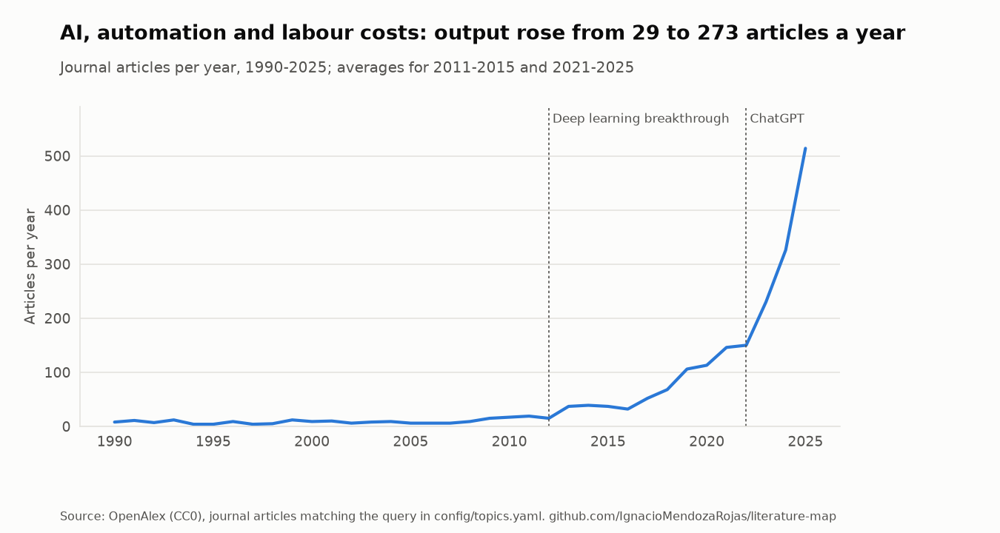
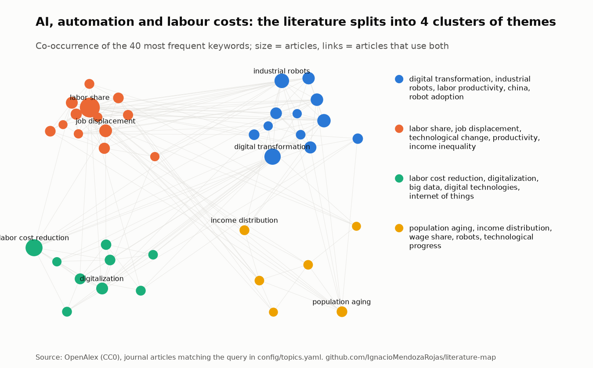
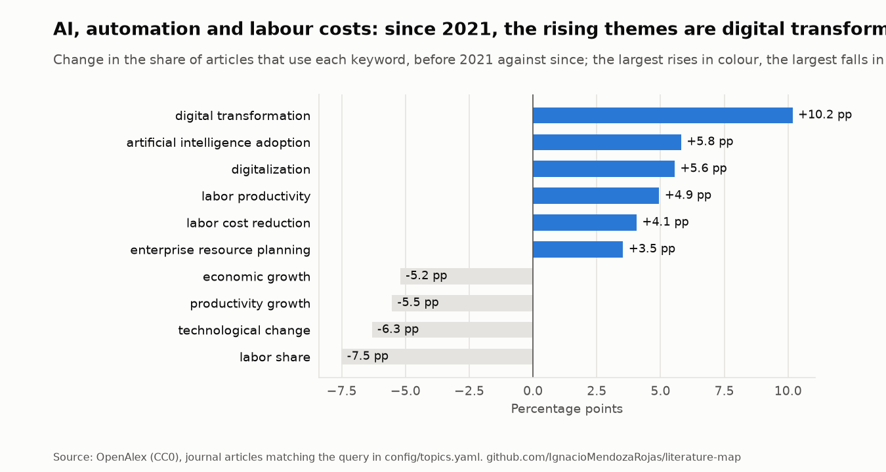

# AI, automation and labour costs

*Rebuilt from OpenAlex on 2026-11-01. Do not edit by hand: see
[`report.py`](../../src/litmap/report.py).*

**Query** (title and abstract, journal articles since 1990):
`("artificial intelligence" OR automation OR robots OR "digital technologies") AND ("labor cost" OR "labour cost" OR "labor costs" OR "labour costs" OR "cost stickiness" OR "sticky costs" OR "cost behavior" OR "cost behaviour" OR "labor share" OR "labour share")`

**Coverage.** 511 articles; 72% of them published in
2021-2025.

<picture>
  <source media="(prefers-color-scheme: dark)" srcset="../figures/ai-and-labour-costs-trend-dark.png">
  
</picture>

## Focus: Technology and cost stickiness

Technology and cost stickiness: 24 of 503 articles, all published since 2022 (7% of the field's output in those years). Pattern on titles and keywords: `stick|asymmetric cost|cost asymmetr|cost behavio`.

| First author | Year | Title | Journal |
|---|---|---|---|
| Zhongyi Xiao | 2026 | [The impact of artificial intelligence adoption on labor cost stickiness: Firm-level evide…](https://openalex.org/W7131308949) | Economic Analysis and Policy |
| Xiuli Zhu | 2026 | [Digital transformation and cost stickiness: a perspective based on resource allocation an…](https://openalex.org/W7161985958) | China Accounting and Finance Review |
| Jiawei Xu | 2026 | [From optimization to disruption: The role of AI-driven innovation in shaping firms’ marke…](https://openalex.org/W7153575677) | Journal of Engineering and Technology Management |
| Xiaofeng Quan | 2026 | [Population aging and corporate asymmetric cost behavior: The roles of labor shortage and…](https://openalex.org/W7222644620) | Journal of Contemporary Accounting & Economics |
| Min Hong | 2026 | [Does industrial robot applications affect asymmetric cost behavior?](https://openalex.org/W7220683852) | Finance research letters |
| Jieying Gao | 2026 | [Unpacking the Spillover Effects of Customers’ AI Adoption: How It Curbs Suppliers’ Cost S…](https://openalex.org/W7165357316) | Systems |
| Yixuan Zhang | 2026 | [Digital transformation and corporate cost stickiness: evidence from Chinese A-Share liste…](https://openalex.org/W7203467259) | Asia-Pacific Journal of Accounting & Economics |
| Peiyan Zhou | 2026 | [How does asymmetric cost behaviour change in digital transformation](https://openalex.org/W7167834194) | International Journal of Mobile Communications |
| Dr. Priyanka Jaiswal | 2026 | [The Role of Artificial Intelligence in Enhancing Supply Chain Efficiency: A Management Ac…](https://openalex.org/W7216139153) | The Journal of Theoretical Accounting Research |
| Triana Novitasari Br Lumban Gaol | 2026 | [Memahami Dan Menganalisis Terminologi, Konsep, Dan Klasifikasi Biaya Dalam Akuntansi Mana…](https://openalex.org/W7165757904) | Journal of Innovative and Creativity (Joecy) |
| Yue Yuan | 2025 | [Achieve sustainable operation of agricultural enterprises: improving agribusiness perform…](https://openalex.org/W4409308238) | Frontiers in Sustainable Food Systems |
| Jinxiang Zang | 2025 | [Does the Digital Transformation of Manufacturing Improve the Technological Innovation Cap…](https://openalex.org/W4408089944) | Sustainability |
| Wei Sun | 2025 | [Digital Innovation and Cost Stickiness in Manufacturing Enterprises: A Perspective Based…](https://openalex.org/W4413023970) | Sustainability |
| Chenyue Zhu | 2025 | [The Impact of Digital Transformation on Cost Stickiness in Enterprises](https://openalex.org/W4411238916) | Journal of Economics and Management Sciences |
| Yosua Samuel Ramli | 2025 | [The Influence of Digital Transformation and Free Cash Flow on Cost Stickiness Moderated b…](https://openalex.org/W7118180272) | Jurnal Ekonomi dan Bisnis Digital |

## Themes and clusters

Keyword communities found by modularity on the co-occurrence network (the method behind
VOSviewer's clustering), largest first:

1. digital transformation, industrial robots, labor productivity, china, robot adoption, artificial intelligence adoption, manufacturing companies, total factor productivity
2. labor share, job displacement, technological change, productivity, income inequality, economic growth, labor market, wages
3. labor cost reduction, digitalization, big data, digital technologies, internet of things, enterprise resource planning, machine learning, digital economy
4. population aging, income distribution, wage share, robots, technological progress, capital-labor substitution

<picture>
  <source media="(prefers-color-scheme: dark)" srcset="../figures/ai-and-labour-costs-map-dark.png">
  
</picture>

<picture>
  <source media="(prefers-color-scheme: dark)" srcset="../figures/ai-and-labour-costs-themes-dark.png">
  
</picture>

## Under-connected themes

Pairs of frequent keywords that appear together far less often than chance would predict. They
are candidates for research gaps, to be read against the literature, not conclusions.

- **labor share** and **digital transformation**: 1 article together, 6 expected if unrelated
- **digital transformation** and **industrial robots**: 1 article together, 3 expected if unrelated
- **labor cost reduction** and **industrial robots**: 2 articles together, 3 expected if unrelated
- **labor share** and **digitalization**: 2 articles together, 3 expected if unrelated
- **labor share** and **artificial intelligence adoption**: 3 articles together, 3 expected if unrelated
- **labor share** and **industrial robots**: 5 articles together, 5 expected if unrelated

## Foundations: the works this field cites most

| First author | Year | Title | Cited by articles here | Share |
|---|---|---|---|---|
| Daron Acemoğlu | 2019 | [Robots and Jobs: Evidence from US Labor Markets](https://openalex.org/W3021644002) | 73 | 15% |
| Georg Graetz | 2018 | [Robots at Work](https://openalex.org/W3122245868) | 68 | 14% |
| Daron Acemoğlu | 2018 | [The Race between Man and Machine: Implications of Technology for Growth, Factor Shares, a…](https://openalex.org/W3125498346) | 64 | 13% |
| Loukas Karabarbounis | 2013 | [The Global Decline of the Labor Share*](https://openalex.org/W2155379226) | 47 | 9% |
| Daron Acemoğlu | 2019 | [Automation and New Tasks: How Technology Displaces and Reinstates Labor](https://openalex.org/W2922903482) | 42 | 8% |
| David Autor | 2003 | [The Skill Content of Recent Technological Change: An Empirical Exploration](https://openalex.org/W2892380133) | 39 | 8% |
| Daron Acemoğlu | 2011 | [Skills, Tasks and Technologies: Implications for Employment and Earnings](https://openalex.org/W3124124240) | 38 | 8% |
| Carl Benedikt Frey | 2016 | [The future of employment: How susceptible are jobs to computerisation?](https://openalex.org/W2526781987) | 37 | 7% |
| David Autor | 2013 | [The Growth of Low-Skill Service Jobs and the Polarization of the US Labor Market](https://openalex.org/W3124401164) | 31 | 6% |
| Daron Acemoğlu | 2020 | [Competing with Robots: Firm-Level Evidence from France](https://openalex.org/W3005100205) | 29 | 6% |

## Most cited articles

| First author | Year | Title | Journal | Citations |
|---|---|---|---|---|
| Daron Acemoğlu | 2018 | [The Race between Man and Machine: Implications of Technology for Growth, Factor Shares, a…](https://openalex.org/W3125498346) | American Economic Review | 3123 |
| Daron Acemoğlu | 2019 | [Automation and New Tasks: How Technology Displaces and Reinstates Labor](https://openalex.org/W2922903482) | The Journal of Economic Perspectives | 2618 |
| Daron Acemoğlu | 2019 | [The wrong kind of AI? Artificial intelligence and the future of labour demand](https://openalex.org/W4230775373) | Cambridge Journal of Regions Economy and Society | 634 |
| Daron Acemoğlu | 2021 | [Demographics and Automation](https://openalex.org/W3169161674) | The Review of Economic Studies | 584 |
| Jay Dixon | 2021 | [The Robot Revolution: Managerial and Employment Consequences for Firms](https://openalex.org/W3144307509) | Management Science | 463 |
| Daron Acemoğlu | 2020 | [Competing with Robots: Firm-Level Evidence from France](https://openalex.org/W3005100205) | AEA Papers and Proceedings | 456 |
| Michael Koch | 2021 | [Robots and Firms](https://openalex.org/W3126711410) | The Economic Journal | 452 |
| David Autor | 2018 | [Is Automation Labor Share-Displacing? Productivity Growth, Employment, and the Labor Share](https://openalex.org/W2800390578) | Brookings Papers on Economic Activity | 384 |
| Carl Benedikt Frey | 2019 | [The Technology Trap: Capital, Labor, and Power in the Age of Automation](https://openalex.org/W2951733402) | Project Muse (Johns Hopkins University) | 303 |
| Svenja Mohr | 2021 | [Acceptance of artificial intelligence in German agriculture: an application of the techno…](https://openalex.org/W3166769082) | Precision Agriculture | 277 |

## Rising: recent articles with the most citations per year

| First author | Year | Title | Journal | Citations a year |
|---|---|---|---|---|
| Emin Dinlersoz | 2023 | [Automation, labor share, and productivity: plant-level evidence from U.S. manufacturing](https://openalex.org/W2892262206) | Economics of Innovation and New Technology | 28.0 |
| Daron Acemoğlu | 2025 | [Power and Progress: Our Thousand-Year Struggle over Technology and Prosperity](https://openalex.org/W4407713486) | Perspectives on Science and Christian Faith | 20.0 |
| Antonio Minniti | 2025 | [AI innovation and the labor share in European regions](https://openalex.org/W4410421805) | European Economic Review | 19.5 |
| Wenbing Luo | 2024 | [The impact of enterprise digital transformation on risk-taking: Evidence from China](https://openalex.org/W4392005796) | Research in International Business and Finance | 18.7 |
| Guimin Qu | 2025 | [Is new technology always good? Artificial intelligence and corporate tax avoidance: Evide…](https://openalex.org/W4407315828) | International Review of Economics & Finance | 17.0 |
| Joel Stiebale | 2024 | [Robots and the rise of European superstar firms](https://openalex.org/W3049047383) | International Journal of Industrial Organization | 13.3 |
| Senlin Lin | 2023 | [Artificial Intelligence in Community-Based Diabetic Retinopathy Telemedicine Screening in…](https://openalex.org/W4321612624) | JMIR Public Health and Surveillance | 13.0 |
| Hongcheng Ling | 2025 | [Digital innovation, human capital allocation, and labour share: Empirical evidence from l…](https://openalex.org/W4410004311) | Journal of Innovation & Knowledge | 12.0 |

## Journals and authors

| Journal | Articles |
|---|---|
| Zenodo (CERN European Organization for Nuclear Research) | 14 |
| EKONOMIKA I UPRAVLENIE PROBLEMY RESHENIYA | 11 |
| RePEc: Research Papers in Economics | 7 |
| Economic Modelling | 7 |
| Economics of Innovation and New Technology | 5 |
| Sustainability | 5 |
| Advances in Economics Management and Political Sciences | 5 |
| Economic Analysis and Policy | 4 |
| World Economy | 4 |
| Systems | 3 |

| Author | Articles |
|---|---|
| Pascual Restrepo | 10 |
| Daron Acemoğlu | 9 |
| Klaus Prettner A | 3 |
| Цинделиани Имеда Анатольевич | 3 |
| Zheng Liu | 2 |
| Emin Dinlersoz | 2 |
| Andreas Irmen | 2 |
| Ilya Manuylov | 2 |
| Michael Koch | 2 |
| Maarten Goos | 2 |

## New since the last update (2026-10-31)

| First author | Year | Title | Journal |
|---|---|---|---|
| Jifan Wang | 2026 | [Opportunity, not risk: How Chinese credit markets price generative AI](https://openalex.org/W7225009832) | International Review of Economics & Finance |
