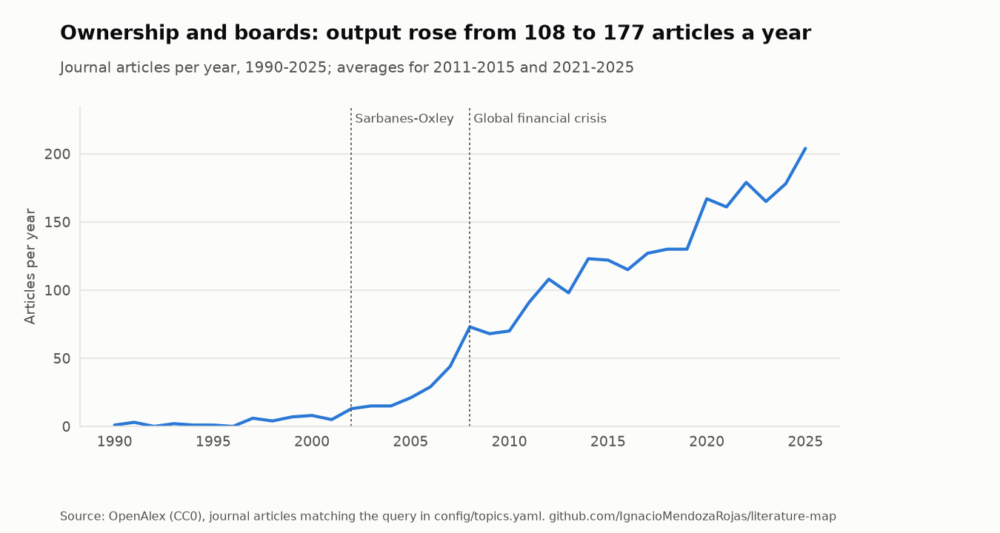
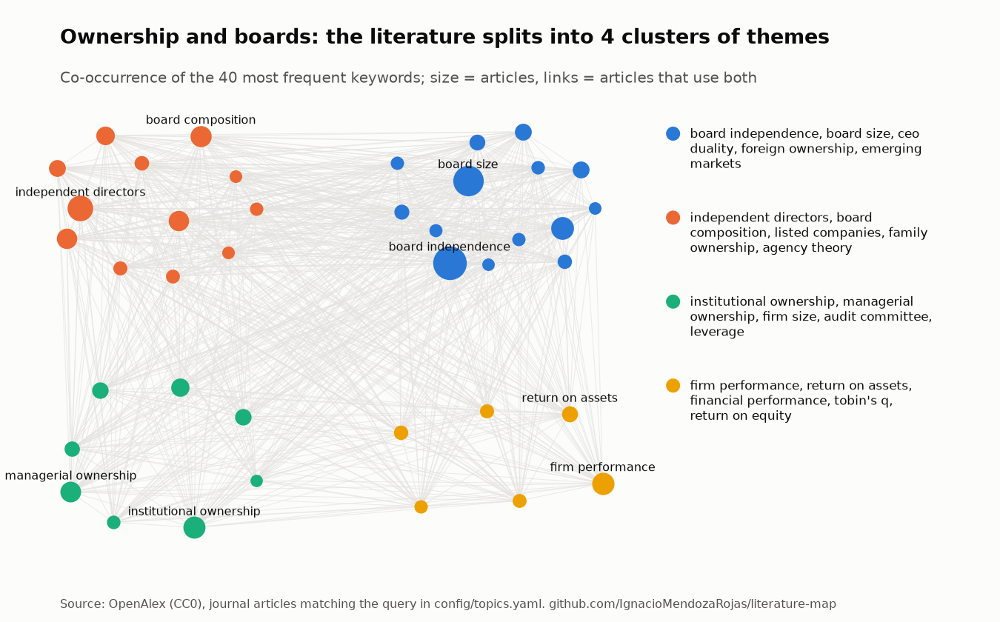
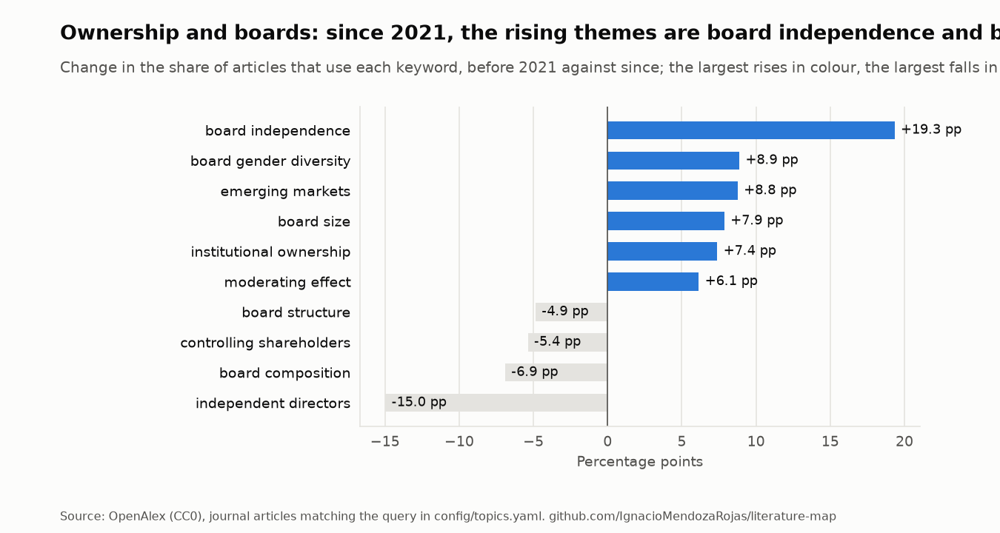

# Ownership and boards

*Rebuilt from OpenAlex on 2026-10-31. Do not edit by hand: see
[`report.py`](../../src/litmap/report.py).*

**Query** (title and abstract, journal articles since 1990):
`("ownership structure" OR "ownership concentration" OR "family ownership" OR blockholder OR blockholders OR "controlling shareholder" OR "large shareholders" OR "owner identity") AND ("board of directors" OR "board composition" OR "board independence" OR "independent directors" OR "board structure" OR "director appointment")`

**Coverage.** 2,906 articles; 36% of them published in
2021-2025.

<picture>
  <source media="(prefers-color-scheme: dark)" srcset="../figures/ownership-and-boards-trend-dark.png">
  
</picture>

## Focus: Ownership heterogeneity and owner identity

Ownership heterogeneity and owner identity: 26 of 2,737 articles, all published since 2008 (1% of the field's output in those years). Pattern on titles and keywords: `owner identity|ownership identity|types? of owners|owner types?|multiple large shareholders|ownership constellation|heterogene`.

| First author | Year | Title | Journal |
|---|---|---|---|
| Xin Cheng | 2026 | [How do emissions trading schemes affect corporate green innovation: the moderating role o…](https://openalex.org/W7168250062) | Journal of Management & Governance |
| Giovanna Gavana | 2025 | [Earnings management in family business research: yesterday, today and tomorrow](https://openalex.org/W4409315659) | Journal of financial reporting & accounting |
| Yiling Zhang | 2025 | [Rookie independent directors and corporate ESG Performance: Evidence from China](https://openalex.org/W4412433122) | International Review of Economics & Finance |
| Sugandh Ahuja | 2024 | [It’s in the group! Role of business group heterogeneity on the performance of M&A deals:…](https://openalex.org/W4403307742) | Managerial Finance |
| Cristina Bettinelli | 2023 | [The influence of board social activity on firm performance](https://openalex.org/W4362671028) | Journal of Family Business Strategy |
| Niklas Bergmann | 2023 | [Heterogeneity in family firm finance, accounting and tax policies: dimensions, effects an…](https://openalex.org/W4383669906) | Journal of Business Economics |
| Caiyu Yan | 2023 | [Multiple Large Shareholders and Firm Performance: Evidence from China*](https://openalex.org/W4381053845) | Asia-Pacific Journal of Financial Studies |
| Samridhi Suman | 2022 | [The Role of Multiple Large Shareholders in Dividend Payouts: Evidence from India](https://openalex.org/W4229053702) | American Business Review |
| Shanzhong Du | 2022 | [Non-actual controllers and corporate innovation: Evidence from China](https://openalex.org/W4286781298) | China Journal of Accounting Research |
| Ilaria Galavotti | 2022 | [When are family firms more likely to make acquisitions? A behavioural agency approach to…](https://openalex.org/W4296843145) | Corporate Ownership and Control |
| Shayan Khan Kakar | 2021 | [Corporate Governance, Risk Management, and Bank Performance: Does Type of Ownership Matte…](https://openalex.org/W3204091782) | Journal of Financial Risk Management |
| Brahmadev Panda | 2019 | [Does Ownership Structure Affect Firm Performance in an Emerging Market? The Case of India](https://openalex.org/W2955585200) | Asian Journal of Business and Accounting |
| Leticia Pérez‐Calero | 2018 | [Do the institutional environment and types of owners influence the relationship between o…](https://openalex.org/W2902306523) | International Review of Financial Analysis |
| Ibrahim Rufai | 2018 | [The impacts of multiple large ownership structure on board independence](https://openalex.org/W4229672610) | International Journal of Accounting Auditing and Performance Evaluation |
| Shahabeddin Shams | 2017 | [Investigation of the Effects of Types of Ownershipon Disposition effect of Mutual funds i…](https://openalex.org/W2751258516) | DOAJ (DOAJ: Directory of Open Access Journals) |

## Themes and clusters

Keyword communities found by modularity on the co-occurrence network (the method behind
VOSviewer's clustering), largest first:

1. board independence, board size, ceo duality, foreign ownership, emerging markets, state ownership, earnings management, board gender diversity
2. independent directors, board composition, listed companies, family ownership, agency theory, board structure, family business, principal-agent problem
3. institutional ownership, managerial ownership, firm size, audit committee, leverage, indonesia stock exchange, manufacturing companies, capital structure
4. firm performance, return on assets, financial performance, tobin's q, return on equity, firm value

<picture>
  <source media="(prefers-color-scheme: dark)" srcset="../figures/ownership-and-boards-map-dark.png">
  
</picture>

<picture>
  <source media="(prefers-color-scheme: dark)" srcset="../figures/ownership-and-boards-themes-dark.png">
  
</picture>

## Under-connected themes

Pairs of frequent keywords that appear together far less often than chance would predict. They
are candidates for research gaps, to be read against the literature, not conclusions.

- **ceo duality** and **indonesia stock exchange**: 1 articles together, 33 expected if unrelated
- **agency theory** and **indonesia stock exchange**: 6 articles together, 20 expected if unrelated
- **emerging markets** and **indonesia stock exchange**: 5 articles together, 16 expected if unrelated
- **board structure** and **indonesia stock exchange**: 5 articles together, 16 expected if unrelated
- **family ownership** and **leverage**: 13 articles together, 30 expected if unrelated
- **board composition** and **indonesia stock exchange**: 12 articles together, 27 expected if unrelated

## Foundations: the works this field cites most

| First author | Year | Title | Cited by articles here | Share |
|---|---|---|---|---|
| Michael C. Jensen | 1976 | [Theory of the firm: Managerial behavior, agency costs and ownership structure](https://openalex.org/W2752617332) | 831 | 30% |
| Eugene F. Fama | 1983 | [Separation of Ownership and Control](https://openalex.org/W3122859634) | 576 | 21% |
| Andrei Shleifer | 1997 | [A Survey of Corporate Governance](https://openalex.org/W3121693921) | 466 | 17% |
| Michael C. Jensen | 1993 | [The Modern Industrial Revolution, Exit, and the Failure of Internal Control Systems](https://openalex.org/W3021889044) | 328 | 12% |
| David Yermack | 1996 | [Higher market valuation of companies with a small board of directors](https://openalex.org/W2074132263) | 306 | 11% |
| Rafael La Porta | 1999 | [Corporate Ownership Around the World](https://openalex.org/W3123091495) | 266 | 10% |
| Andrei Shleifer | 1986 | [Large Shareholders and Corporate Control](https://openalex.org/W2135241016) | 258 | 9% |
| Randall Mørck | 1988 | [Management ownership and market valuation](https://openalex.org/W1606272114) | 234 | 9% |
| Eugene F. Fama | 1980 | [Agency Problems and the Theory of the Firm](https://openalex.org/W2160184254) | 228 | 8% |
| Harold Demsetz | 1985 | [The Structure of Corporate Ownership: Causes and Consequences](https://openalex.org/W1991795148) | 200 | 7% |

## Most cited articles

| First author | Year | Title | Journal | Citations |
|---|---|---|---|---|
| Benjamin E. Hermalin | 1991 | [The Effects of Board Composition and Direct Incentives on Firm Performance](https://openalex.org/W1977528366) | Financial Management | 2313 |
| Li Li Eng | 2003 | [Corporate governance and voluntary disclosure](https://openalex.org/W2069712330) | Journal of Accounting and Public Policy | 1967 |
| Sanjai Bhagat | 2007 | [Corporate Governance and Firm Performance](https://openalex.org/W4237866076) | Journal of Corporate Finance | 1750 |
| Hoje Jo | 2011 | [Corporate Governance and Firm Value: The Impact of Corporate Social Responsibility](https://openalex.org/W2036829732) | Journal of Business Ethics | 1604 |
| Hollis Ashbaugh Skaife | 2006 | [The effects of corporate governance on firms’ credit ratings](https://openalex.org/W3121156620) | Journal of Accounting and Economics | 1321 |
| Ronald C. Anderson | 2004 | [Board Composition: Balancing Family Influence in S&P 500 Firms](https://openalex.org/W3124866554) | Administrative Science Quarterly | 1154 |
| Robert M. Bushman | 2003 | [Financial accounting information, organizational complexity and corporate governance syst…](https://openalex.org/W3124681717) | Journal of Accounting and Economics | 1059 |
| Barry D. Baysinger | 1991 | [EFFECTS OF BOARD AND OWNERSHIP STRUCTURE ON CORPORATE R&D STRATEGY.](https://openalex.org/W1987715081) | Academy of Management Journal | 949 |
| Anil Shivdasani | 1993 | [Board composition, ownership structure, and hostile takeovers](https://openalex.org/W2014524200) | Journal of Accounting and Economics | 906 |
| Stuart Gillan | 2006 | [Recent Developments in Corporate Governance: An Overview](https://openalex.org/W2035551893) | Journal of Corporate Finance | 877 |

## Rising: recent articles with the most citations per year

| First author | Year | Title | Journal | Citations a year |
|---|---|---|---|---|
| Bruno Buchetti | 2024 | [A literature review on corporate governance and ESG research: Emerging trends and future…](https://openalex.org/W4404202412) | International Review of Financial Analysis | 32.3 |
| Waseem Akhter | 2023 | [Does corporate social responsibility mediate the relationship between corporate governanc…](https://openalex.org/W4385837895) | Corporate Social Responsibility and Environmental Management | 16.0 |
| Subhas Mondal | 2024 | [Unveiling the moderating role of governance mechanism on the nexus between CSR and firm p…](https://openalex.org/W4402499120) | Corporate Social Responsibility and Environmental Management | 14.0 |
| Asuman Erben Yavuz | 2024 | [The Impact of Corporate Governance on Sustainability Disclosures: A Comparison from the P…](https://openalex.org/W4402929122) | Sustainability | 13.7 |
| Pei-Gi Shu | 2024 | [Board network and ESG performance: Evidence from China](https://openalex.org/W4399920157) | Corporate Social Responsibility and Environmental Management | 13.3 |
| Shms Alduha Abualhassan | 2024 | [Does corporate governance moderate the impact of earnings management on capital structure…](https://openalex.org/W4396691807) | Discover Sustainability | 13.3 |
| Arshad Hasan | 2023 | [Corporate governance and tax avoidance: evidence from an emerging market](https://openalex.org/W4362695657) | Applied Economics | 13.0 |
| Ahmed Imran Hunjra | 2023 | [How do corporate governance and corporate social responsibility affect credit risk?](https://openalex.org/W4387504414) | Research in International Business and Finance | 12.8 |

## Journals and authors

| Journal | Articles |
|---|---|
| Zenodo (CERN European Organization for Nuclear Research) | 68 |
| Corporate Ownership and Control | 61 |
| Corporate Governance | 51 |
| RePEc: Research Papers in Economics | 45 |
| DOAJ (DOAJ: Directory of Open Access Journals) | 45 |
| Corporate Governance An International Review | 34 |
| DJA (Diponegoro Journal of Accounting) | 23 |
| Corporate Board role duties and composition | 19 |
| Journals & Books Hosting (International Knowledge Sharing Platform) | 18 |
| International Journal of Business and Management | 18 |

| Author | Articles |
|---|---|
| Onipe Adabenege Yahaya | 34 |
| Khaled Hussainey | 10 |
| Hafiza Aishah Hashim | 9 |
| Yuan George Shan | 9 |
| Juan Manuel San Martín Reyna | 7 |
| Azhar Abdul Rahman | 6 |
| Nejla Ould Daoud Ellili | 6 |
| Félix J. López‐Iturriaga | 6 |
| Shamsul Nahar Abdullah | 6 |
| Balwinder Singh | 6 |

## New since the last update (2026-10-31)

| First author | Year | Title | Journal |
|---|---|---|---|
| Najah Attig | 2007 | [Family pyramidal holdings and board of directors](https://openalex.org/W2087968741) | International Journal of Business Governance and Ethics |
| Nadhilwan Rashad Lambri | 2020 | [Pengaruh corporate governance terhadap firm performance pada perusahaan manufaktur yang t…](https://openalex.org/W3024901973) | SKRIPSI-2020 |
| Emma García‐Meca | 2009 | [Corporate Governance and Earnings Management: A Meta‐Analysis](https://openalex.org/W2146237944) | Corporate Governance An International Review |
| Shima Korbacheh | 2012 | [Offering a Model to describe the Relationship between Corporate Governance Factors and Re…](https://openalex.org/W2182304530) |  |
| Widijaya Widijaya | 2022 | [KARAKTERISTIK DEWAN DIREKSI, KOMITE AUDIT, DAN KEPEMILIKAN TERHADAP KINERJA PERUSAHAAN](https://openalex.org/W4310542380) | Jurnal Ekonomi Pembangunan STIE Muhammadiyah Palopo |
| Viet Quoc Pham | 2020 | [Effects of corporate governance on high growth rate: evidence from Vietnamese listed comp…](https://openalex.org/W2998281912) | Management Science Letters |
| Afzalur Rashid | 2008 | [The influence of ownership structures and board practices on corporate social disclosures…](https://openalex.org/W2779675691) | University of Southern Queensland ePrints (University of Southern Queensland) |
| Linda Azlinda Sahlan | 2025 | [Corporate Governance and Accounting Conservatism: Exploring the Linkages and Implications](https://openalex.org/W4406599771) | International Journal of Research and Innovation in Social Science |
| Fabrizio Fratini | 2015 | [Corporate Governance and Performance: Evidence from Italian Companies](https://openalex.org/W2014777645) | Open Journal of Business and Management |
| Affaf Asghar Butt | 2020 | [Role of discretionary earning management in corporate governance-value and corporate gove…](https://openalex.org/W3018002146) | Corporate Governance |
