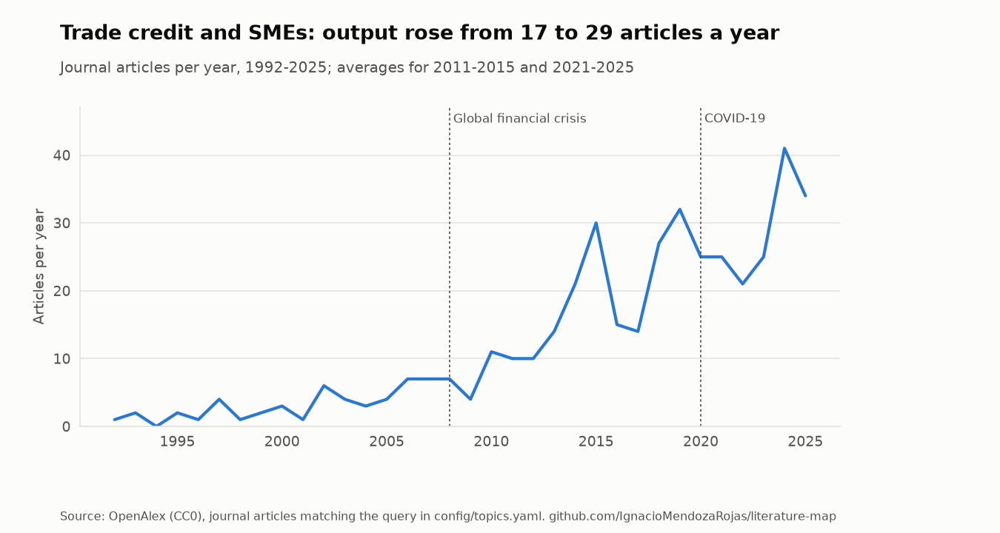
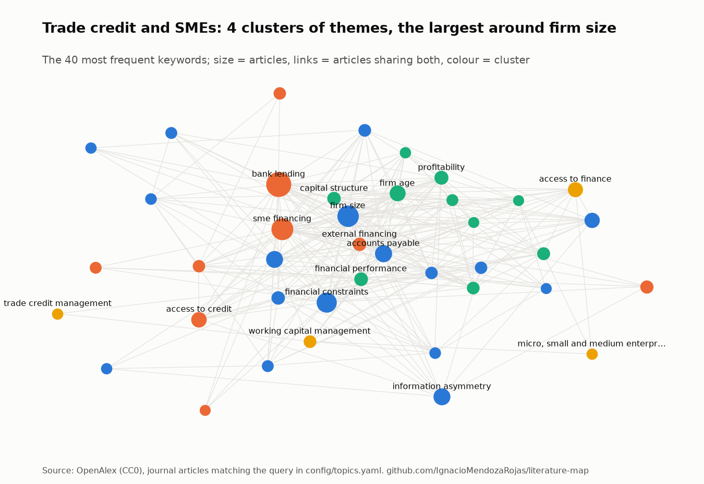
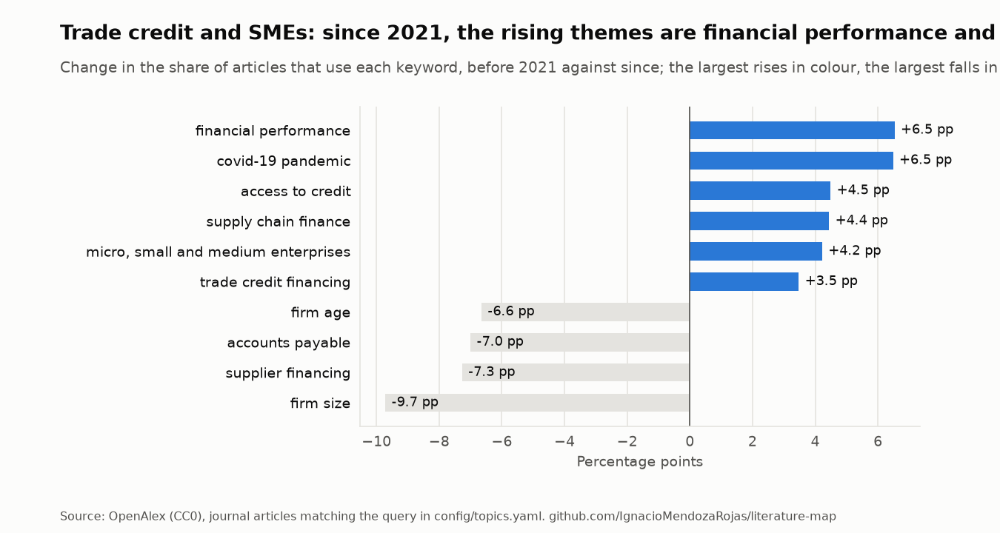

# Trade credit and SMEs

*Rebuilt from OpenAlex on 2026-10-31. Do not edit by hand: see
[`report.py`](../../src/litmap/report.py).*

**Query** (title and abstract, journal articles since 1990):
`"trade credit" AND (SME OR SMEs OR "small and medium" OR "small business" OR "small firms")`

**Coverage.** 443 articles; 35% of them published in
2021-2025. The original review found 146 articles in Scopus with a narrower query (articles with both terms in title, abstract or keywords).

<picture>
  <source media="(prefers-color-scheme: dark)" srcset="../figures/trade-credit-smes-trend-dark.png">
  
</picture>

## Themes and clusters

Keyword communities found by modularity on the co-occurrence network (the method behind
VOSviewer's clustering), largest first:

1. firm size, financial constraints, accounts payable, information asymmetry, accounts receivable, financial crisis, supplier financing, 2008 financial crisis
2. bank lending, sme financing, access to credit, external financing, supply chain finance, small business financing, informal finance, trade credit financing
3. firm age, profitability, financial performance, capital structure, debt financing, equity financing, short-term debt, retained earnings
4. access to finance, working capital management, micro, small and medium enterprises, trade credit management

<picture>
  <source media="(prefers-color-scheme: dark)" srcset="../figures/trade-credit-smes-map-dark.png">
  
</picture>

<picture>
  <source media="(prefers-color-scheme: dark)" srcset="../figures/trade-credit-smes-themes-dark.png">
  
</picture>

## Under-connected themes

Pairs of frequent keywords that appear together far less often than chance would predict. They
are candidates for research gaps, to be read against the literature, not conclusions.

- **sme financing** and **accounts receivable**: 0 articles together, 6 expected if unrelated
- **firm size** and **information asymmetry**: 0 articles together, 5 expected if unrelated
- **bank lending** and **working capital management**: 0 articles together, 4 expected if unrelated
- **information asymmetry** and **accounts receivable**: 0 articles together, 3 expected if unrelated
- **firm size** and **supply chain finance**: 1 articles together, 3 expected if unrelated
- **bank lending** and **financial performance**: 2 articles together, 5 expected if unrelated

## Foundations: the works this field cites most

| First author | Year | Title | Cited by articles here | Share |
|---|---|---|---|---|
| Mitchell A. Petersen | 1997 | [Trade Credit: Theories and Evidence](https://openalex.org/W3021995853) | 151 | 34% |
| Vicente Cuñat | 2006 | [Trade Credit: Suppliers as Debt Collectors and Insurance Providers](https://openalex.org/W3124863821) | 89 | 20% |
| Bruno Biais | 1997 | [Trade Credit and Credit Rationing](https://openalex.org/W2024365411) | 88 | 20% |
| Raymond J. Fisman | 2003 | [Trade Credit, Financial Intermediary Development, and Industry Growth](https://openalex.org/W3124834107) | 77 | 17% |
| Chee K. Ng | 1999 | [Evidence on the Determinants of Credit Terms Used in Interfirm Trade](https://openalex.org/W2164367837) | 77 | 17% |
| J. Stephen Ferris | 1981 | [A Transactions Theory of Trade Credit Use](https://openalex.org/W2013704297) | 74 | 17% |
| Mike C. Burkart | 2004 | [In-Kind Finance: A Theory of Trade Credit](https://openalex.org/W2605496294) | 73 | 16% |
| Janet Kiholm Smith | 1987 | [Trade Credit and Informational Asymmetry](https://openalex.org/W2023128559) | 72 | 16% |
| Allen N. Berger | 1998 | [The economics of small business finance: The roles of private equity and debt markets in…](https://openalex.org/W2119780569) | 69 | 16% |
| Jeffrey H. Nilsen | 2002 | [Trade Credit and the Bank Lending Channel](https://openalex.org/W3122858800) | 68 | 15% |

## Most cited articles

| First author | Year | Title | Journal | Citations |
|---|---|---|---|---|
| Mitchell A. Petersen | 1997 | [Trade Credit: Theories and Evidence](https://openalex.org/W3021995853) | Review of Financial Studies | 2602 |
| Bruno Biais | 1997 | [Trade Credit and Credit Rationing](https://openalex.org/W2024365411) | Review of Financial Studies | 982 |
| Mike C. Burkart | 2004 | [In-Kind Finance: A Theory of Trade Credit](https://openalex.org/W2605496294) | American Economic Review | 969 |
| Jeffrey H. Nilsen | 2002 | [Trade Credit and the Bank Lending Channel](https://openalex.org/W3122858800) | Journal of money credit and banking | 628 |
| Susan Coleman | 2000 | [Access to Capital and Terms of Credit: A Comparison of Men- and Women- Owned Small Busine…](https://openalex.org/W187857710) | Journal of Small Business Management | 591 |
| Eddie Casey | 2014 | [Bank lending constraints, trade credit and alternative financing during the financial cri…](https://openalex.org/W2029710399) | Journal of Corporate Finance | 416 |
| Santiago Carbó Valverde | 2016 | [Trade Credit, the Financial Crisis, and SME Access to Finance](https://openalex.org/W3021442314) | Journal of money credit and banking | 408 |
| Nicholas Wilson | 2002 | [Trade Credit Terms Offered by Small Firms: Survey Evidence and Empirical Analysis](https://openalex.org/W2153809978) | Journal of Business Finance &amp Accounting | 348 |
| Jyrki Niskanen | 2006 | [The Determinants of Corporate Trade Credit Policies in a Bank-dominated Financial Environ…](https://openalex.org/W2110055662) | European Financial Management | 249 |
| Pedro J. García‐Teruel | 2010 | [Determinants of trade credit: A comparative study of European SMEs](https://openalex.org/W2169994114) | International Small Business Journal Researching Entrepreneurship | 234 |

## Rising: recent articles with the most citations per year

| First author | Year | Title | Journal | Citations a year |
|---|---|---|---|---|
| Hengrui Bai | 2023 | [Does digital financial inclusion lead to regional differences in trade credit financing?:…](https://openalex.org/W4388261466) | Economic Analysis and Policy | 7.5 |
| Greta Falavigna | 2023 | [SMEs’ behavior under financial constraints: An empirical investigation on the legal envir…](https://openalex.org/W4323306137) | The North American Journal of Economics and Finance | 7.2 |
| Wilbert Manyanga | 2023 | [The effect of debt financing on the financial performance of SMEs in Zimbabwe](https://openalex.org/W4388698864) | Cogent Social Sciences | 5.8 |
| Huan Cong Hoang | 2023 | [Does national culture impact trade credit provision of SMEs?](https://openalex.org/W4361294902) | Economic Modelling | 5.2 |
| Jody Grewal | 2024 | [Payment Practices Transparency and Customer‐Supplier Dynamics](https://openalex.org/W4391606035) | Journal of Accounting Research | 5.0 |
| Zhiyuan Zhen | 2024 | [The evolution of portfolio financing equilibrium in a risk-averse supply chain under a pa…](https://openalex.org/W4391685495) | Finance research letters | 4.3 |
| Maria Cristina Arcuri | 2023 | [Access to external credit during COVID-19: evidence from green SMEs in Italy](https://openalex.org/W4362717946) | Review of Managerial Science | 4.2 |
| Lu Liu | 2024 | [Financing provision strategies for third‐party logistics with consideration of supply cha…](https://openalex.org/W4405829052) | International Transactions in Operational Research | 4.0 |

## Journals and authors

| Journal | Articles |
|---|---|
| RePEc: Research Papers in Economics | 23 |
| Small Business Economics | 14 |
| International Small Business Journal Researching Entrepreneurship | 7 |
| Zenodo (CERN European Organization for Nuclear Research) | 7 |
| Finance research letters | 7 |
| Journal of Small Business Management | 6 |
| International Journal of Managerial Finance | 6 |
| Sustainability | 5 |
| The Journal of Entrepreneurial Finance | 5 |
| Emerging Markets Finance and Trade | 5 |

| Author | Articles |
|---|---|
| Peter Öhman | 13 |
| Darush Yazdanfar | 13 |
| Pedro J. García‐Teruel | 7 |
| Pedro Martínez Solano | 6 |
| Filippo di Pietro | 6 |
| María-José Palacín-Sánchez | 6 |
| W. Otto | 6 |
| Daisuke Tsuruta | 6 |
| Susan Coleman | 6 |
| Francisco-Javier Canto-Cuevas | 5 |

## New since the last update (first run)

_No new articles._
